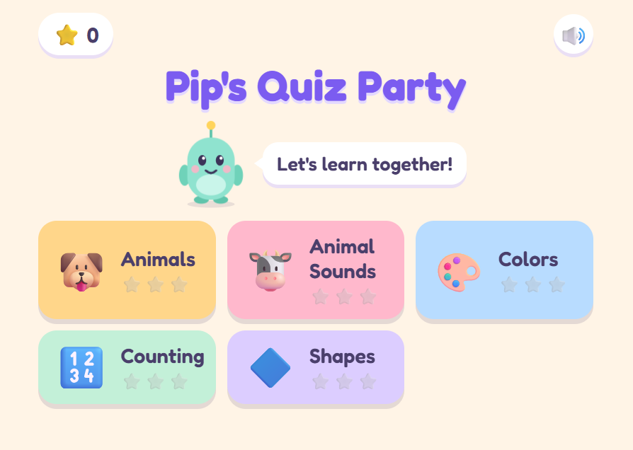
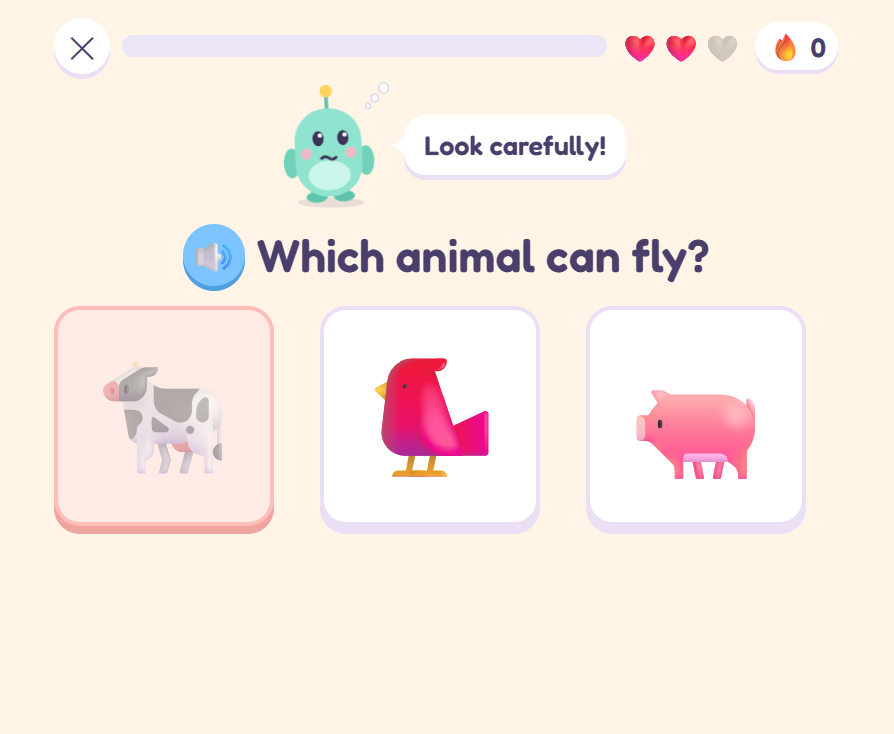
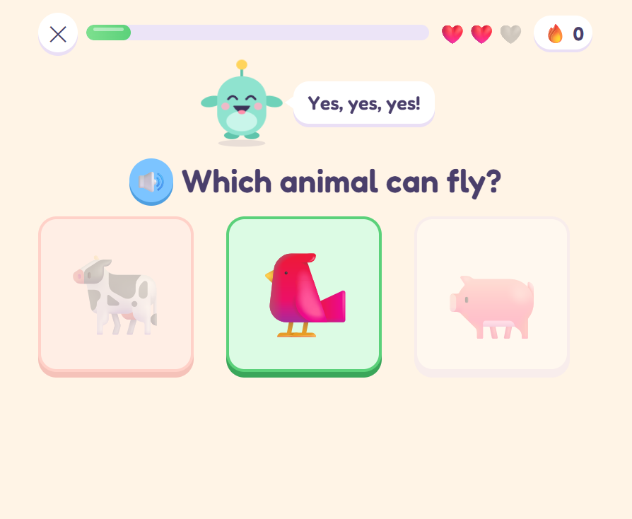
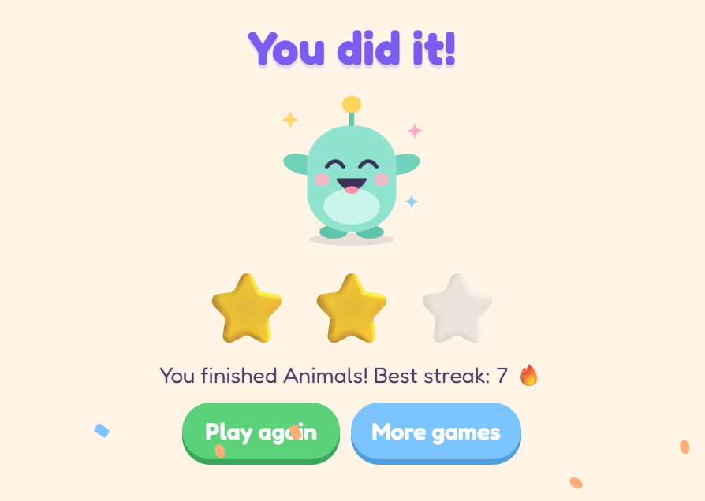

# Pip's Quiz Party

A cheerful quiz game for kids aged 4 to 6. Pip, a friendly little robot, reads each question out loud, cheers when your child gets it right, and gently encourages them to try again when they don't.

It runs in any web browser, including on a tablet. Nothing needs to be installed.



## Screenshots

| Pick an answer | Got it right! | Lesson finished |
|---|---|---|
|  |  |  |

## What's inside

- **5 lessons, 40 questions:** Animals, Animal Sounds, Colors, Counting and Shapes. Each lesson has 8 questions.
- **Picture answers:** every question has 3 big picture buttons, so children don't need to read.
- **Read aloud:** each question is spoken automatically. Tap the 🔊 button to hear it again.
- **Pip the mascot:** Pip bounces, cheers, wobbles and thinks along with your child, and says something different each time.
- **Hearts, streaks and stars:** a progress bar, 3 hearts, a 🔥 streak counter, confetti, and 1 to 3 stars at the end of each lesson.
- **No harsh failures:** a wrong answer can always be retried. After two misses, the right answer gently glows. Running out of hearts never ends the game, and finishing always earns at least 1 star.
- **Private:** no ads, no accounts and no data collection. Stars are saved only in the browser on your device.

## Play it

The game needs to be opened from a web address, not by double-clicking `index.html`, because the browser blocks the questions file otherwise.

**On a computer**, with Python installed, run this in the game folder:

```
python -m http.server
```

Then open http://localhost:8000 in your browser.

**On a tablet or phone**, turn on GitHub Pages for this repository (Settings → Pages → branch `main`, folder `/ (root)`). The game will then be at `https://<your-username>.github.io/Kids_Games/`.

## Add your own questions

All questions live in [questions.json](questions.json). Each lesson has a title, an icon, a card color and a list of questions. Each question has a `prompt`, the index of the right `answer`, and 3 `choices`. A choice can be one of these:

| Type | Example |
|---|---|
| Emoji picture | `{ "pic": "🐱", "label": "cat" }` |
| Color circle | `{ "swatch": "#ef4444", "label": "red" }` |
| Shape | `{ "shape": "star", "color": "#fbbf24", "label": "star" }` (circle, square, triangle, star, heart or diamond) |
| Number | `{ "num": "3" }` |

Add `"show": "🍎🍎🍎"` to a question to display a big picture above the answers, as the Counting lesson does. Answers are shuffled every time, so the right one doesn't always appear in the same place.

## Files

| File | What it does |
|---|---|
| `index.html` | The page and its three screens: home, play and finished |
| `style.css` | Colors, layout and all the animations |
| `game.js` | Game logic, the Pip mascot, sounds and reading aloud |
| `questions.json` | All lessons and questions |

Sounds are made in the browser, so there are no audio files. The font is Fredoka from Google Fonts.
